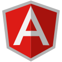
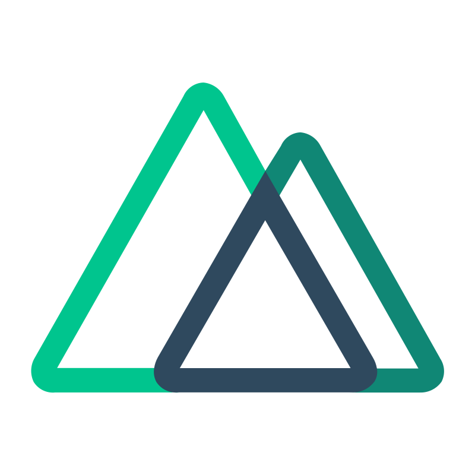
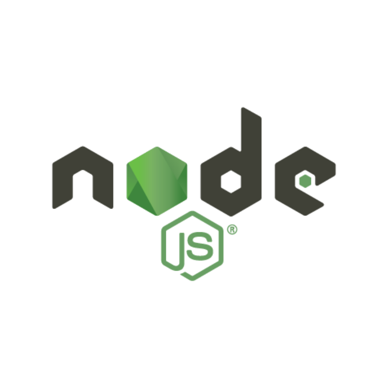

<h1 align="center">Hola 👋, soy wilmar Aley Ramirez Gil</h1>
<h3 align="center">👨‍💻 Desarrollador Full Stack apasionado por crear soluciones eficientes e innovadoras</h3>

---

### 🚀 Sobre mí

- 🎓 Tecnólogo en Análisis y Desarrollo de Sistemas de Información
- 🎓 Estudiante de Ingeniería de Sistemas
- 👨‍💻 +2 años de experiencia desarrollando soluciones web full stack
- 🚀 He liderado equipos backend y participado en múltiples integraciones de APIs externas
- ☁️ Experiencia en despliegue de proyectos en AWS
- 🧠 En constante aprendizaje y evolución tecnológica

---

### 🛠️ Tecnologías y herramientas

  
  
  
  
  
  
  
  
  
  
  

---

# Estadísticas de mi perfil de GitHub

<!-- <table width="70%">
  <tr>
    <td><h3>GitHub Stats</h3></td>
    <td><h3>Lenguajes más usados</h3></td>
  </tr>
  <tr>
    <td>
      
    </td>
    <td>
      
    </td>
  </tr>
</table>
<table width="70%"> -->

<tr>
<tr>
    <td><h3>Trofeos de GitHub</h3></td>
  </tr>
    <td>
    
     </td>
  </tr>
</table>

<table width="70%">

<tr>
<tr>
    <td><h3>Gráfico de actividad</h3></td>
  </tr>
    <td>
    
     </td>
  </tr>
</table>

---

### 📫 Cómo contactarme

- 📧 Email: wilmar.0614@gmail.com
- 💼 LinkedIn: www.linkedin.com/in/wilmar-ramirez-812a60263
- 🌐 Portafolio:.

---

💬 _Gracias por visitar mi perfil. ¡Construyamos algo juntos!_
